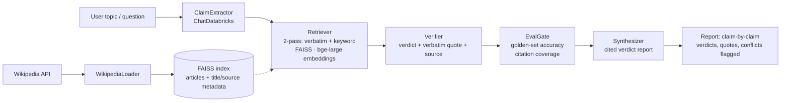

# Aimpoint take-home — design brief

_Prepared Wed Oct 14, 2026 (evening) so the design decisions are made before the wedding trip. The build itself is planned for Mon–Wed Oct 19–21; a reminder is already set for Mon Oct 19, 9:10 AM ET._

## The assignment, from the scaffold notebook itself

Source: `01_agentic_wikipedia_aimpoint_interview.ipynb` in this folder (read in full Oct 14).

- **Task:** design, build, and explain a *novel* agentic workflow over a subset of the Wikipedia dataset, with a distinctive GenAI use case you define yourself. Implemented in **Databricks Free Edition**, starting from the provided notebook.
- **Deliverables:**
  1. **Reference architecture** (PDF or PNG) showing the approach, including technical agentic-workflow details.
  2. **The completed notebook** — Part A (GenAI Application Development: your workflow code) and Part B (Reflection) — validated with **Run All**, then exported **File → Export → HTML → print to PDF**. The submission must be a PDF.
- **Deadline:** ~Wed Oct 21, 2026 (one week from the Oct 14 assessment email; confirm the exact date/time from Gloria's email before submitting).
- **Stated expected effort:** 90 minutes to 2.5 hours.

### Rules of the road (quoted/paraphrased from the notebook — they matter)

- "You may use coding assistants for this assignment, but you must provide your own custom prompts and demonstrate your own critical thinking."
- "**Large language models must not be used to generate responses for the open-response questions in Part B**" (the Reflection).
- So, deliberately: **this brief contains no reflection draft and no finished prompt text.** It gives you the design, the structure, and what each of your prompts needs to constrain. The prompts and the reflection stay in your words. Jot 2–3 raw notes per build session (what surprised you, what you'd fix) — those notes become Part B almost verbatim.

## What's already in the scaffold (so the design fits it)

- **Loader:** `WikipediaLoader(query=query_terms, load_max_docs=max_docs)` — returns each article's first sections plus metadata: `title`, `summary`, `source` (article URL). Loading takes **~10 minutes per 1,000 articles**; Aimpoint recommends ≤10k docs and starting small.
- **Retrieval:** FAISS vector store built for you, using `DatabricksEmbeddings` with endpoint `databricks-bge-large-en`. Default `k = 2`.
- **LLM:** `ChatDatabricks`, default endpoint `databricks-meta-llama-3-1-8b-instruct`. The config comment names an alternative: `databricks-gpt-oss-20b`. The 8B default is small — fine for extraction, shaky as a judge (see design note below).
- **Config TODOs you must change:** `query_terms` (defaults to sports terms — must match your use case) and `max_docs` (defaults to 10).
- **Stack pinned in cell 1:** LangGraph 0.5.3, LangChain, chromadb/faiss-cpu available. The notebook itself warns package dependencies may drift — **smoke-test first** (below).
- **Setup:** the Databricks Free Edition workspace steps are in `AIE Assessment.pdf` in this folder (screenshot-based, 3 pages). If you haven't created the workspace yet, that's step zero on Monday — it needs your sign-up, so it's your hand, ~10 minutes.

## Recommended design: "CrossCheck" — cited claim verification over Wikipedia

**Use case in one line:** Given a topic or question, decompose it into atomic, checkable claims; verify each claim against retrieved Wikipedia evidence; return a claim-by-claim verdict report where every verdict carries a quoted evidence span and a source citation — plus a built-in eval that scores the system against claims with known answers.

**Why this one (the Principal-level signals it sends):**

- It is *not* another Wikipedia chatbot/Q&A wrapper, which is what most submissions will be — the assignment explicitly grades novelty of the use case and design thinking, not just working code.
- It operationalizes the two positions you took in the screen and were praised for: retrieval method should fit the data (here: two retrieval passes, merged — a pragmatic hybrid), and **evals are the hardest production problem** — so the eval is a node in the graph, not an afterthought.
- Every component maps onto code the scaffold already gives you (loader, FAISS, ChatDatabricks), so the 90-minute–2.5-hour budget goes to design and prompts, not plumbing.

**Corpus:** a fact-dense domain where articles overlap heavily, so claims get checked against multiple sources. Suggested starting point — Apollo / Space Race:

```python
query_terms = ["Apollo program", "Space Race", "Apollo 11", "Saturn V",
               "Gemini program", "Soviet space program", "Moon landing", "NASA"]
max_docs = 300   # ~3–5 min load; raise only if retrieval feels thin
```

Dates, firsts, crews, and mission outcomes recur across these articles, which gives the verifier real work — including genuine emphasis differences between articles to flag.

**Graph shape (LangGraph `StateGraph`):**

1. **ClaimExtractor** — LLM node. Input: user topic/question. Output: a list of atomic claims (one fact each), stored in graph state. Prompt must constrain: claims are single-fact, self-contained, and checkable against an encyclopedia.
2. **Retriever** — per claim, two passes over the FAISS store: (a) the claim verbatim, (b) a keyword/entity reformulation of the claim. Merge, dedupe by source title, keep top ~4 passages with metadata (`title`, `source` URL) attached. This is the "hybrid" story without needing a second index.
3. **Verifier** — LLM node, per claim. Output is structured: `verdict` ∈ {supported, refuted, insufficient-evidence}, a **verbatim quote** from a retrieved passage backing the verdict, and the source title. Prompt must constrain: no verdict without a quote; if the passages don't settle it, the answer is insufficient-evidence, not a guess. _Design note:_ this is the reasoning-heaviest node — if the 8B default struggles, point this node (only) at `databricks-gpt-oss-20b` and say why in a notebook comment; model-per-node selection is itself a design decision worth showing.
4. **EvalGate** — plain-Python node (no LLM). Runs the workflow over a small golden set — ~6 claims you label by hand with known verdicts (mix of supported / refuted / insufficient, e.g. one plausible-sounding falsehood about a mission date). Reports verdict accuracy on the golden set and **citation coverage** (% of verdicts carrying a quote + source). Prints both numbers in the notebook output — graders see them without hunting.
5. **Synthesizer** — LLM node. Compiles the final report: claim-by-claim table (claim → verdict → quote → source), flags any claim where two sources' passages pull in different directions, and a one-paragraph summary. Must not introduce facts that aren't in the verifier outputs.

**State:** `{question, claims[], evidence{claim_id: [passages]}, verdicts[], eval_metrics{}, report}`.

## Fallback design (if you want to stay at the low end of the effort range)

**Multi-perspective research brief:** Planner decomposes a question into 3–4 sub-questions → parallel retrieval per sub-question → synthesizer writes a sourced brief and explicitly flags where articles disagree. ~60–90 minutes to build, reuses the same corpus and retriever. Less distinctive than CrossCheck — no verifier, no eval — but safe. Decide Monday after the smoke test, not before.

## Reference architecture (deliverable 1)

Mermaid source — render to PNG/PDF for submission, or redraw in any diagram tool:



## Work plan (fits around the trip; ~2.5–3 hrs total, trimmable)

- **Mon Oct 19 — smoke test + corpus (~30–45 min).** Create/confirm the Databricks workspace (per `AIE Assessment.pdf`), import the notebook, Run All *unedited* to catch dependency drift early. Then set `query_terms`/`max_docs`, load the corpus, confirm the example retrieval + LLM calls return sane output. _(Note: Monday also carries the Gamma contract signature deadline — separate lane, already tracked.)_
- **Tue Oct 20 — build (~90 min).** Implement the five nodes in Part A, write your prompts, hand-label the ~6 golden claims, run the EvalGate, iterate on the verifier prompt until golden-set accuracy and citation coverage look respectable. Jot your Part B notes as you go.
- **Wed Oct 21 — finish (~30–45 min).** Fresh Run All end-to-end, export HTML → PDF, render the architecture diagram to PDF/PNG, write Part B in your own words from your notes, submit both files.

## Gotchas worth knowing before Monday

- **Loader time is the silent budget-killer:** every `query_terms`/`max_docs` change can cost minutes of reload. Decide the corpus once, cache the loaded docs in a variable, and don't re-run cell 3 casually.
- **The loader returns first sections only** — claims should target lead-section-level facts (dates, firsts, outcomes), not deep-article trivia, or everything comes back "insufficient-evidence."
- **`k = 2` is low for verification** — the design above retrieves per claim with merged passes partly to compensate; if verdicts look starved, raising `k` is a one-line change.
- **Deadline precision:** "~Oct 21" comes from "within one week" in the assessment email and your screen notes. The Monday reminder already instructs checking the email for the exact deadline — do that before planning Wednesday around it.
